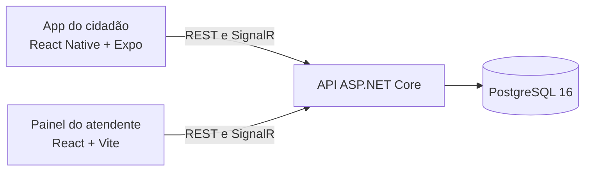
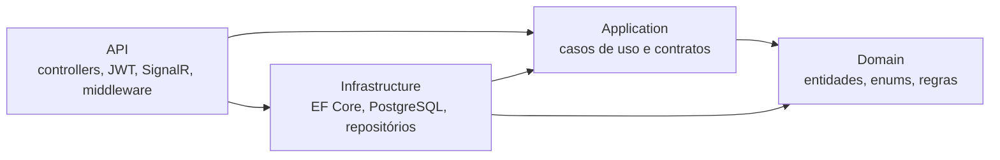
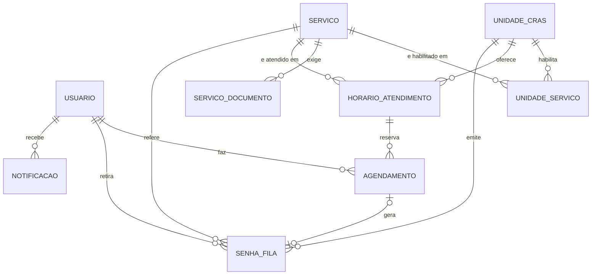

# FilaVirtual

Agendamento e fila virtual para os atendimentos do CadÚnico nos CRAS, com um app para o cidadão e um painel para o atendente, atualizados em tempo real.


> **Projeto acadêmico de simulação.** O FilaVirtual não tem integração com o gov.br, com o CadÚnico nem com nenhum CRAS real. Ele usa apenas a identidade visual do [Design System do Governo Federal (GovBR-DS)](https://www.gov.br/ds/). Os dados de exemplo (unidades, serviços e contas) são fictícios.

## Sumário

- [O problema](#o-problema)
- [Funcionalidades](#funcionalidades)
- [Telas](#telas)
- [Arquitetura](#arquitetura)
- [Tecnologias](#tecnologias)
- [Como executar](#como-executar)
- [Contas de teste](#contas-de-teste)
- [Testes](#testes)
- [Estrutura do repositório](#estrutura-do-repositório)
- [Decisões e limitações](#decisões-e-limitações)
- [Fluxo de trabalho no Git](#fluxo-de-trabalho-no-git)
- [Como o projeto foi desenvolvido](#como-o-projeto-foi-desenvolvido)
- [Licença](#licença)

## O problema

Quem precisa de atendimento do CadÚnico costuma chegar cedo ao CRAS, esperar em pé sem saber a posição e, muitas vezes, descobrir só no balcão que faltou um documento. O FilaVirtual resolve três pontos:

1. **Agendar** o atendimento em poucos toques, já sabendo quais documentos levar.
2. **Entrar na fila de casa** e acompanhar a posição em tempo real, em vez de esperar no local.
3. **Organizar o atendimento** para a equipe, com a fila ordenada por prioridade e indicadores do dia.

## Funcionalidades

### Cidadão (app mobile)

- Cadastro e login com validação de CPF.
- Lista de unidades ordenada por distância (quando o aparelho permite a localização), com endereço, horário de funcionamento, telefone e o checklist de documentos de cada serviço.
- Agendamento em quatro etapas (unidade, serviço, data e hora, confirmação), com QR Code de check-in.
- Consulta, cancelamento e remarcação de agendamentos.
- Entrada remota na fila e acompanhamento em tempo real: senha, posição, progresso, tempo estimado e quem está sendo chamado.
- Avisos no aparelho quando a vez se aproxima, quando a senha é chamada e quando há imprevisto na unidade.
- Pessoas com 60 anos ou mais recebem senha preferencial automaticamente.

### Atendente (painel web)

- Emissão de senha presencial para quem chega ao balcão.
- Chamada da próxima senha informando o guichê, conclusão do atendimento e retirada de senhas da fila.
- Fila de espera ordenada (preferenciais primeiro, depois por ordem de chegada).
- Indicadores do dia e aviso de imprevisto para os cidadãos da unidade.
- O administrador acessa qualquer unidade.

### Regras de negócio principais

| Regra | Como é garantida |
| --- | --- |
| Preferencial passa na frente do normal, e dentro de cada grupo vale a ordem de chegada | Ordenação da fila por prioridade e horário de emissão |
| Idoso (60 anos ou mais) recebe senha preferencial | Calculado a partir da data de nascimento, sem depender do cidadão informar |
| Senhas legíveis e diárias (`N007`, `P007`) | Numeração por dia no fuso de São Paulo, com índice único e nova tentativa em caso de colisão |
| Uma única senha ativa por pessoa | Validação no caso de uso ao entrar na fila |
| Última vaga de um horário não pode ser vendida duas vezes | Contador de vagas ocupadas com controle de concorrência otimista (`xmin`); o perdedor recebe `409 Conflict` |
| CPF válido e único | Validador de dígitos no domínio e índice único, guardado só com dígitos |

## Telas

As imagens abaixo ficam em `docs/imagens/`.

| Início | Acompanhar fila | Avisos |
| --- | --- | --- |
|  |  |  |

| Unidade | Serviço | Data e hora | Confirmação |
| --- | --- | --- | --- |
|  |  |  |  |

## Arquitetura

O sistema tem três partes que conversam com a mesma API: o app do cidadão, o painel do atendente e o banco de dados.



O back-end segue **Clean Architecture**: as dependências apontam sempre para dentro, e as regras de negócio não conhecem banco, framework web nem biblioteca externa.



| Camada | Responsabilidade |
| --- | --- |
| **Domain** | Entidades com construtores que validam e setters privados, enums, `DomainException` e o validador de CPF. Não depende de nada. |
| **Application** | Casos de uso (autenticação, agendamento, fila, painel, notificações) e as interfaces que a infraestrutura implementa. |
| **Infrastructure** | `AppDbContext`, configurações Fluent API por entidade, migrations, repositórios e a carga inicial de dados de desenvolvimento. |
| **API** | Endpoints REST, autenticação JWT, hub SignalR, tratamento global de erros (ProblemDetails), CORS e Swagger. |

### Modelo de dados



### Tempo real

O hub SignalR (`/hubs/fila`) agrupa as conexões por usuário (`usuario-{id}`) e por unidade (`unidade-{id}`). Quando o atendente chama uma senha, o app de quem está na fila é atualizado sem recarregar a tela, e a posição dos demais muda sozinha.

### Segurança

- Autenticação por JWT (8 horas), com `sub`, e-mail, perfil e unidade nas claims.
- Senhas com hash BCrypt.
- Perfis separados (cidadão, atendente, administrador), com a conta de atendente recusada no app do cidadão.
- Erros devolvidos como ProblemDetails, sem expor detalhes internos.
- CORS configurável por variável de ambiente.

## Tecnologias

| Área | Tecnologias |
| --- | --- |
| API | .NET 10, ASP.NET Core, Entity Framework Core 10, Npgsql, SignalR, JWT, BCrypt, Swagger |
| Banco | PostgreSQL 16 (Docker) |
| Painel | React, TypeScript, Vite, componentes `@govbr-ds/webcomponents-react` |
| App | React Native, Expo, expo-router, TypeScript |
| Testes | xUnit (back-end), Jest (app) e Testing Library (painel e app) |
| Design | GovBR-DS 3.7.0 (tokens, cores e componentes) |

## Como executar

### Pré-requisitos

- [.NET SDK 10](https://dotnet.microsoft.com/download)
- [Node.js](https://nodejs.org/) 20 ou superior
- [Docker](https://www.docker.com/) com Docker Compose
- Ferramenta do EF Core: `dotnet tool install --global dotnet-ef`

Os comandos abaixo usam PowerShell. Em Linux ou macOS, troque `$env:NOME="valor"` por `export NOME="valor"`.

### 1. Clonar o repositório

```powershell
git clone https://github.com/fellipegms06/fila-virtual.git
cd fila-virtual
```

### 2. Subir o banco de dados

```powershell
docker compose up -d
```

O PostgreSQL fica disponível em `localhost:5433` (usuário `fila`, senha `fila123`, banco `filavirtual`). Esses valores existem apenas para desenvolvimento local.

### 3. Criar as tabelas

```powershell
cd backend
dotnet ef database update --project src/FilaVirtual.Infrastructure --startup-project src/FilaVirtual.API
```

### 4. Executar a API

```powershell
$env:Cors__Origens__0="http://localhost:5173"
$env:Cors__Origens__1="http://localhost:8081"
dotnet run --project src/FilaVirtual.API --launch-profile http
```

A API sobe em `http://localhost:5171`, e o Swagger fica em `http://localhost:5171/swagger`. No ambiente de desenvolvimento ela também cria as unidades, os serviços, os horários e as [contas de teste](#contas-de-teste). As duas variáveis `Cors__Origens__*` liberam as origens do painel e do app web.

### 5. Executar o painel do atendente

Em outro terminal:

```powershell
cd painel-web
Copy-Item .env.example .env
npm install
npm run dev
```

Acesse `http://localhost:5173`. A variável `VITE_API_URL` do arquivo `.env` aponta para a API.

### 6. Executar o app do cidadão

Em outro terminal, crie o arquivo `mobile/.env` com o endereço da API:

```
EXPO_PUBLIC_API_URL=http://localhost:5171
```

e inicie o app:

```powershell
cd mobile
npm install
npx expo start --web
```

O app abre em `http://localhost:8081`. Para ver como no celular, use o modo de dispositivo do navegador (F12, depois Ctrl+Shift+M) com 360 por 800.

Outras formas de abrir o app:

| Onde | Como |
| --- | --- |
| Emulador Android | `npx expo start`, tecla `a`, com `EXPO_PUBLIC_API_URL=http://10.0.2.2:5171` |
| Celular real (Expo Go) | `npx expo start`, ler o QR Code, com `EXPO_PUBLIC_API_URL=http://IP-DO-SEU-PC:5171` e a API iniciada com `--urls http://0.0.0.0:5171`. O celular e o computador devem estar na mesma rede. |

Se o app abrir com um visual antigo, pare o Metro e inicie de novo com `npx expo start --web --clear`.

## Contas de teste

Criadas automaticamente apenas em ambiente de desenvolvimento.

| Perfil | E-mail | Senha | Observação |
| --- | --- | --- | --- |
| Administrador | `admin@filavirtual.dev` | `admin12345` | Acessa todas as unidades |
| Atendente | `atendente1@filavirtual.dev` | `atendente123` | Unidade Central |
| Atendente | `atendente2@filavirtual.dev` | `atendente123` | Unidade Norte |
| Atendente | `atendente3@filavirtual.dev` | `atendente123` | Unidade Sul |
| Cidadão | `cidadao@filavirtual.dev` | `cidadao123` | Nascimento em 1992 (senha normal) |
| Cidadão idoso | `idoso@filavirtual.dev` | `cidadao123` | Nascimento em 1950 (senha preferencial) |

A conta de atendente é recusada no app do cidadão.

### Roteiro rápido para ver tudo funcionando

1. No app, entre como cidadão e como idoso (use uma janela anônima para a segunda sessão).
2. Nos dois, entre na fila do mesmo serviço da Unidade Central.
3. No painel, entre como `atendente1`. A senha preferencial do idoso aparece na frente da do cidadão.
4. Chame a próxima senha informando um guichê. O app do idoso mostra a chamada na hora e o do cidadão avança uma posição.
5. Conclua o atendimento e chame a seguinte.

## Testes

```powershell
# Back-end
cd backend
dotnet build
dotnet test

# Painel
cd ../painel-web
npm test

# App
cd ../mobile
npm run typecheck
npm run lint
npm test
```

O back-end tem testes das regras de domínio e dos casos de uso. O painel e o app têm testes de componentes e telas.

## Estrutura do repositório

```
fila-virtual/
├── backend/
│   ├── FilaVirtual.sln
│   ├── src/
│   │   ├── FilaVirtual.Domain/           entidades, enums, regras
│   │   ├── FilaVirtual.Application/      casos de uso e contratos
│   │   ├── FilaVirtual.Infrastructure/   EF Core, migrations, repositórios
│   │   └── FilaVirtual.API/              endpoints, JWT, SignalR
│   └── tests/FilaVirtual.Tests/
├── painel-web/                           painel do atendente (React + Vite)
├── mobile/                               app do cidadão (Expo + React Native)
└── docker-compose.yml                    PostgreSQL para desenvolvimento
```

## Decisões e limitações

- **Sem integração com o gov.br.** É uma simulação: não há login único, consulta ao CadÚnico nem dados reais.
- **Notificações locais, sem push remoto.** Os avisos chegam pelo app enquanto ele está aberto, com SignalR. Push via FCM exigiria conta e credenciais externas e foi deixado de fora de propósito.
- **GovBR-DS no app mobile.** Os componentes web do GovBR-DS não rodam em React Native. Por isso as cores, espaçamentos e raios foram recriados a partir dos tokens oficiais da versão 3.7.0 em `mobile/src/theme/tokens.ts`. O painel usa os componentes oficiais diretamente.
- **Fonte do sistema.** A fonte Rawline, do GovBR-DS, não vem no pacote `@govbr-ds/core`, que só a referencia por um CDN. O app usa a fonte do sistema.
- **Acessibilidade.** Texto com no mínimo 16 pontos, alvos de toque de pelo menos 44 pixels e pares de cores conferidos para contraste AA. Por isso os cartões ficam um pouco maiores que no protótipo de referência.
- **Histórico de chamadas.** A tela de acompanhamento mostra a senha em atendimento, mas não o histórico das anteriores, porque a API informa apenas a senha chamada no momento.
- **Barra de progresso da fila.** A API não informa a posição inicial de quem entrou, então o app guarda a maior posição vista enquanto está aberto.
- **Dados de exemplo só em desenvolvimento.** A carga inicial e as contas de teste não rodam em outros ambientes.

## Fluxo de trabalho no Git

- `main` guarda versões estáveis e `develop` integra o trabalho.
- Cada funcionalidade nasce em uma branch `feature/*` a partir de `develop` e entra por Pull Request.
- Os commits seguem o formato `Verbo: descrição`, no imperativo e em português (`Adiciona`, `Corrige`, `Remove`, `Atualiza`, `Refatora`, `Renomeia`, `Documenta`), com uma mudança lógica por commit.

## Licença

Distribuído sob a licença MIT. Veja o arquivo [LICENSE](LICENSE).
